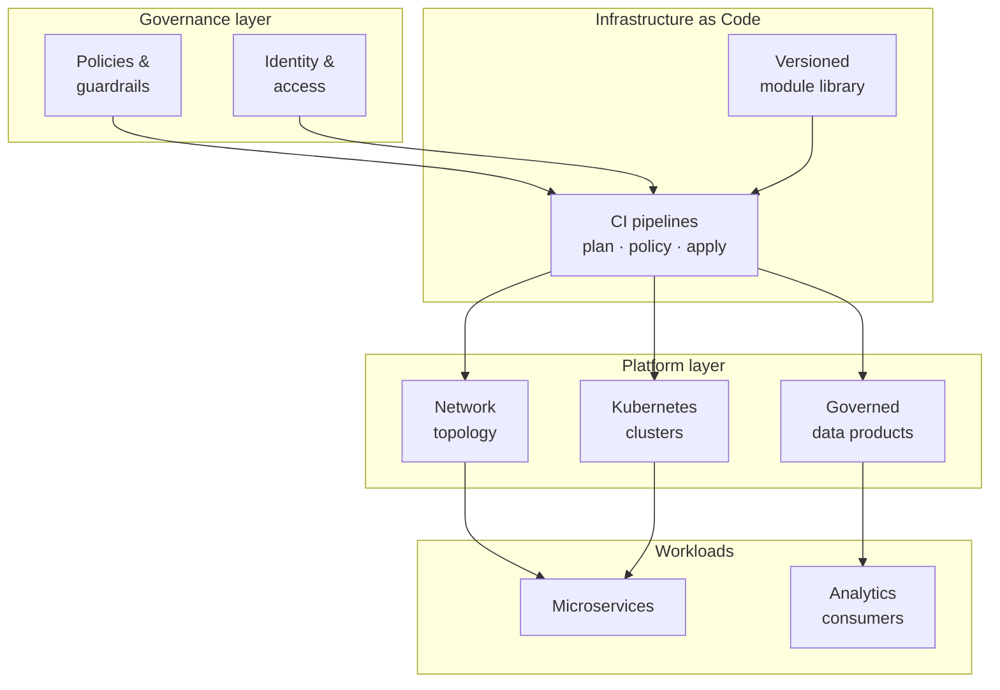

<h1 align="center">Matheus Americano</h1>

  <strong>Cloud Infrastructure Architect</strong> 
  Multi-cloud platforms for regulated, high-stakes environments

  
  
  

---

I build the Terraform standards and Kubernetes platforms that regulated,
high-criticality environments run on — the kind where every change is auditable
and downtime is not an option. I work across three clouds, lead cloud squads
technically, and teach the same material as a Microsoft Certified Trainer.

### Platforms & tooling

### How I think about platform work

Reusable modules are the unit of governance: if the baseline is correct in the
module, every environment inherits it — and the pipeline, not a checklist,
is what enforces it.

### Focus areas

| Area | What that means in practice |
|---|---|
| **Infrastructure as Code at scale** | Versioned module libraries, semantic releases, policy-as-code in the pipeline |
| **Multi-cloud landing zones** | Project/subscription hierarchy, network topology, identity federation, guardrails |
| **Kubernetes platform engineering** | Cluster baselines, RBAC, network policy, ingress and observability across GKE, AKS and IKS |
| **Resilience & capacity** | Sizing and hardening for critical, time-boxed traffic events at national scale |
| **Data platform architecture** | Hub-and-spoke designs that let business units share data products under central governance |
| **Enablement** | Turning architecture decisions into documentation and training that outlive the project |

### Certifications

### Currently

- Technical lead for cloud squads in a highly regulated financial environment
- Publishing reference architectures and reusable Terraform modules here
- Studying for **HashiCorp Terraform Associate (004)** and **CKA**
- Teaching official Microsoft courses as an MCT

### Languages

Portuguese (native) · English (professional working) · Spanish (basic)

  Everything published here is reference material written from scratch — no client code, configuration or data.

